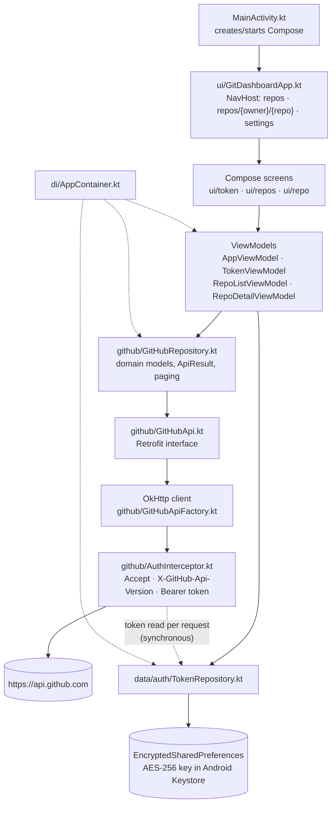

# Git Dashboard

An Android app for browsing your GitHub repositories from a phone: sign in with a personal access
token, list and filter your repositories, and open a repository's details.

- **Package / application ID:** `com.agentroost.gitdashboard`
- **Version:** `0.1.0` (versionCode 1)
- **UI:** Jetpack Compose (Material 3)
- **Source root:** `app/src/main/java/com/agentroost/gitdashboard/`

> **Status note:** the repository list and repository detail screens are wired up. The in-app file
> browser / code viewer is **not** wired to navigation yet — see
> [Known limitations](#known-limitations).

---

## Screenshots

No screenshots are committed yet. Drop the files below into `docs/screenshots/` and replace the
placeholder cells; the table is the checklist of shots a release should have.

| Screen | File | What to capture |
| --- | --- | --- |
| Token onboarding | `docs/screenshots/01-onboarding.png` | Empty state, "Connect your GitHub account" |
| Token verified | `docs/screenshots/02-token-verified.png` | "Verified as &lt;login&gt;" + "Continue to repositories" |
| Repository list | `docs/screenshots/03-repo-list.png` | Populated list showing private badge, stars, language |
| Repository filter | `docs/screenshots/04-repo-filter.png` | Non-empty filter query with matches |
| Repository detail | `docs/screenshots/05-repo-detail.png` | Header, stats grid, "Browse files" / "Open on GitHub" |
| Settings / sign out | `docs/screenshots/06-settings.png` | Masked saved token + "Remove saved token" |
| Error state | `docs/screenshots/07-error.png` | Rate-limit or network error pane |

---

## Requirements

| Component | Version | Where it comes from |
| --- | --- | --- |
| JDK | **17** | `app/build.gradle.kts` → `sourceCompatibility`/`targetCompatibility` = 17, `jvmTarget = "17"` |
| Android SDK Platform | **35** | `compileSdk = 35`, `targetSdk = 35` |
| Android Studio | Ladybug (2024.2.1) or newer | Needed for the bundled JDK, SDK manager and Gradle tooling for Android Gradle Plugin **8.7.3** (**not verified here** — Studio is not installed in this environment) |
| Gradle | **8.9** | The build cache in this workspace is `.gradle/8.9/`, so that is the version it was last built with; AGP 8.7.3 requires Gradle 8.9+ |
| Kotlin | 2.0.21 | `gradle/libs.versions.toml` |
| Device / emulator | **Android 8.0 (API 26) or newer** | `minSdk = 26` |

You also need:

- A GitHub account and a personal access token (see [Create a personal access token](#create-a-personal-access-token)).
- Network access to `https://api.github.com` **from the phone**, not just from your laptop.

---

## Build and install

### Option A — Android Studio (recommended)

1. **File → Open…** and pick the project directory (`/home/core/GitDashboard` in this workspace).
2. Let Gradle sync finish. If Studio asks for an SDK location, point it at your Android SDK and it
   writes `local.properties` for you.
3. Plug in a phone with USB debugging enabled (Settings → About phone → tap *Build number* 7 times,
   then Settings → System → Developer options → *USB debugging*), or start an emulator with an
   API 26+ system image.
4. Select the `app` run configuration and press **Run ▶**.

### Option B — command line

```sh
# From the project root
./gradlew installDebug
```

This compiles the debug variant and installs it on the one connected device/emulator.

**Not verified here.** This workspace has **no Gradle wrapper** — there is no `gradlew`,
no `gradlew.bat` and no `gradle/wrapper/gradle-wrapper.jar` (checked with `ls`/`find`) — and the
machine has no JDK, Gradle, Android SDK or `adb` installed (`java`, `gradle`, `adb` all report
"not found"). So `./gradlew installDebug` has not been executed in this environment. See
[Troubleshooting](#troubleshooting) → *"gradlew: not found" / wrapper jar missing*.

If your checkout *does* have the wrapper (a normal clone does), the equivalent explicit tasks are:

```sh
./gradlew :app:assembleDebug      # build only, not verified here
./gradlew :app:installDebug       # build + install, not verified here
```

### Install onto a physical device with adb

```sh
adb devices                       # confirm the phone is listed as "device", not "unauthorized"
adb install -r app/build/outputs/apk/debug/app-debug.apk
```

- `adb` ships with the Android SDK platform-tools; with a default Android Studio install on Linux it
  is at `~/Android/Sdk/platform-tools/adb`. **Not verified here** (`adb` is not installed and there
  is no SDK directory in this environment).
- The APK output path is real: `app/build/outputs/apk/debug/app-debug.apk` exists in this workspace.
- Over Wi-Fi: *Developer options → Wireless debugging* on the phone, then
  `adb pair <ip>:<port>` followed by `adb connect <ip>:<port>`. **Not verified here.**

Add `adb` to your `PATH` for the session if needed:

```sh
export PATH="$HOME/Android/Sdk/platform-tools:$PATH"   # default Studio SDK location; adjust if yours differs
```

### If Gradle cannot find the SDK

The build needs an SDK path from one of these (in order of precedence):

1. `sdk.dir=/absolute/path/to/Android/Sdk` in a `local.properties` file at the project root —
   this file is **not** present in this workspace and is machine-specific, so it is not committed.
2. The `ANDROID_HOME` environment variable.
3. `ANDROID_SDK_ROOT` (legacy).

Creating `local.properties`:

```sh
printf 'sdk.dir=%s\n' "$HOME/Android/Sdk" > local.properties
```

**Not verified here** (no SDK installed, and no build has been run in this environment).

---

## Create a personal access token

The app authenticates with a **personal access token (PAT)** and sends it as
`Authorization: Bearer <token>` on every call to `api.github.com`. There is no OAuth flow and no
password login.

Open <https://github.com/settings/tokens> and choose one of the two token types.

### Classic token (simplest)

1. *Settings → Developer settings → Personal access tokens → Tokens (classic) → Generate new token
   (classic)*.
2. Name it something like `git-dashboard-phone`.
3. Expiration: your choice — the app has no refresh mechanism, so an expired token simply starts
   returning 401 and you re-paste a new one.
4. Scopes:
   - **`repo`** — required to read **private** repositories (contents, metadata). There is no
     read-only variant of this scope; classic `repo` also grants write access, so treat the token as
     sensitive.
   - Nothing else is required. Public repositories are readable with a token that carries no scopes,
     and `GET /user` (used for verification) works with any valid token.
5. Generate, then copy the `ghp_…` value immediately — GitHub shows it once.

### Fine-grained token (least privilege, recommended)

1. Same page → *Fine-grained tokens → Generate new token*.
2. **Resource owner:** your account (or the org that owns the repos — an org may need to approve the
   request).
3. **Repository access:** *All repositories*, or *Only select repositories* and pick the ones you
   want to see in the app.
4. **Permissions → Repository permissions → Contents: Read-only.** *Metadata: Read-only* is added
   automatically and cannot be removed. No other permissions are needed.
5. Generate and copy the `github_pat_…` value.

Practical differences that matter for this app:

| | Classic | Fine-grained |
| --- | --- | --- |
| Prefix | `ghp_…` | `github_pat_…` |
| Granularity | Account-wide scopes | Per-repository, per-permission |
| Private repo read | `repo` scope (also grants write) | `Contents: Read-only` on selected/all repos |
| Visible repositories | Every repo the account can see | Only the repos selected on the token |

Because fine-grained tokens are scoped per repository, a fine-grained token limited to one repository
will show only that repository in the list. If private repositories are missing, check
*Repository access* first, then the *Contents* permission.

The app verifies a token against `GET /user` **before** saving it, so a mistyped or under-scoped
token is rejected on the onboarding screen rather than silently stored.

---

## First run and usage walkthrough

### 1. Onboarding (first launch only)

No token is stored, so the app opens the **GitHub access** screen:

1. Paste the token into **Personal access token** (input is masked, tokens are case-sensitive — don't
   add spaces).
2. Tap **Verify token**. This calls `GET /user` with a throw-away HTTP client bound to the candidate
   token, so an invalid token never replaces a working one.
3. On success you see **Verified as &lt;your login&gt;**. On failure you see the mapped error message
   (see [Troubleshooting](#troubleshooting)).
4. Tap **Continue to repositories**. The token is stored encrypted on the device and the repository
   list loads.

Note: the token is saved only after GitHub accepts it. If the device's Keystore is unusable, the
app shows *"Secure storage is unavailable on this device, so the token cannot be saved."* and does
**not** fall back to plaintext storage.

### 2. Repository list

`GET /user/repos` with `sort=updated`, `affiliation=owner,collaborator,organization_member`,
30 per page.

- Rows show name, private badge, stars, description, owner · language · "Updated …".
- **Filter by name** is client-side: it matches the repository `name` or `fullName` of rows already
  loaded, case-insensitively. It does not call GitHub's search API.
- Bottom of the list: **Load more** while more pages exist, otherwise **Refresh**.
- On HTTP 401 the app clears the stored token and returns to onboarding.

### 3. Repository detail

Tap a row → `GET /repos/{owner}/{repo}` is loaded once.

- Header: name, owner, visibility badge, Fork / Archived badges, description.
- Stats: stars, forks, watchers. Then default branch, language, last-updated.
- **Refresh** in the top bar re-runs the request.
- **Open on GitHub** opens the repository's `html_url` in your browser.

### 4. Settings / signing out

Gear icon on the repository list → **Settings**:

- Shows the saved token masked as `ghp_…1a2b` (first and last four characters).
- **Remove saved token** wipes the encrypted entry and drops you back on onboarding.
- Pasting a new token and verifying it replaces the old one; the authenticated screen graph is
  recreated, so no cached data from the previous account survives.

---

## Architecture

One OkHttp client per process, a single Retrofit interface, and a manually constructed dependency
container (`di/AppContainer.kt` — no Hilt/Koin).

```
UI (Compose)  ->  ViewModel  ->  Repository  ->  GitHubApi (Retrofit)  ->  OkHttp  ->  api.github.com
                     |                                ^
                     |                                |
                     +--> TokenRepository             +-- AuthInterceptor reads the token per request
                          (EncryptedSharedPreferences + Android Keystore)
```



### Layers and the files that implement them

| Layer | File(s) | Responsibility |
| --- | --- | --- |
| Entry point | `app/src/main/java/com/agentroost/gitdashboard/MainActivity.kt`, `GitDashboardApplication.kt` | Hosts Compose; the `Application` builds `AppContainer` |
| DI | `app/src/main/java/com/agentroost/gitdashboard/di/AppContainer.kt` | Owns the token repository, the OkHttp client, `GitHubApi`, `GitHubRepository` |
| Navigation | `app/src/main/java/com/agentroost/gitdashboard/ui/GitDashboardApp.kt` | `Routes.REPOS`, `Routes.REPO_DETAIL`, `Routes.SETTINGS`; onboarding vs. authenticated graph |
| UI | `ui/token/TokenScreen.kt`, `ui/repos/RepoListScreen.kt`, `ui/repo/RepoDetailScreen.kt`, `ui/components/*` | Compose screens + shared error/empty/loading panes |
| ViewModels | `ui/AppViewModel.kt` (session), `ui/token/TokenViewModel.kt`, `ui/repos/RepoListViewModel.kt`, `ui/repo/RepoDetailViewModel.kt` | State machines; expose `StateFlow` UI state; one in-flight request at a time |
| Repository | `github/GitHubRepository.kt` | The only API surface ViewModels see; maps DTO → domain, decodes paging |
| Network | `github/GitHubApi.kt`, `GitHubApiFactory.kt`, `AuthInterceptor.kt`, `ApiCall.kt`, `ApiResult.kt`, `Paging.kt`, `GitHubContentDecoder.kt` | Retrofit endpoints, headers, error mapping, `Link` pagination, base64 decoding |
| Wire models | `github/model/GitHubDtos.kt` | `@Serializable` DTOs |
| Domain models | `domain/model/Repository.kt`, `domain/model/Contents.kt` | What the UI renders |
| Token storage | `data/auth/TokenRepository.kt` | `EncryptedSharedPreferences` (`git_dashboard_secure_tokens`, key `github_pat`), AES-256-GCM master key in the Keystore |

### Error handling

`github/ApiCall.kt` wraps every call in `safeApiCall`, which runs on `Dispatchers.IO` and converts
transport exceptions, non-2xx statuses and decode failures into the typed `ApiError` sealed interface
(`Unauthorized`, `RateLimited`, `Forbidden`, `NotFound`, `Http`, `Network`, `Serialization`,
`Unknown`). No exception text reaches the UI; `ui/components/ApiErrorText.kt` maps each error to a
string resource. Rate-limit reset times come from `X-RateLimit-Reset` and are rendered as a local
clock time.

### Token storage model

- Written only after `GET /user` accepts the token (`TokenViewModel.verifyAndSave`).
- Encrypted at rest with `EncryptedSharedPreferences`; the master key lives in the Android Keystore.
- Read **per request** through `AuthInterceptor`, so replacing the token does not rebuild the network
  stack.
- On session expiry (401) it is deleted (`AppViewModel.onSessionExpired`).
- No logging interceptor is installed, deliberately: an HTTP logger would print the
  `Authorization` header.

---

## Troubleshooting

| Symptom | Likely cause | Fix |
| --- | --- | --- |
| Onboarding shows *"GitHub rejected the token. Please enter a valid personal access token."* (HTTP 401) | Token revoked, expired, copied incompletely, or created for a different account | Create a new token at <https://github.com/settings/tokens>, copy the whole value (`ghp_…` / `github_pat_…`), paste without spaces/trailing newline, tap **Verify token**. If a token was already stored, the app has cleared it and returned to onboarding — paste the new one. |
| *"This token is not allowed to access the requested data."* (403 that is not a rate limit), or GitHub's own 403 message | Token lacks the scope/permission, or the org requires SSO authorization | Classic: add the `repo` scope. Fine-grained: `Contents: Read-only` plus *Repository access* covering that repo. For org repos, authorize the token for the org (SSO). GitHub's own message is shown when it sends one. |
| *"GitHub rate limit exceeded. It resets at 14:32."* (or the variant without a time) | HTTP 403 with `X-RateLimit-Remaining: 0`, or HTTP 429 (secondary limit) | Wait until the reset time shown (device local time, from `X-RateLimit-Reset`). Authenticated requests typically allow 5,000/hour; the app makes one call per screen/refresh, but repeated **Refresh** taps still count. If no time is shown, GitHub sent no reset header — wait a minute and retry. |
| *"Network error. Check your connection and retry."* | Airplane mode, no Wi-Fi/cellular, captive portal, DNS/TLS failure, or a timeout | Restore connectivity and retry. The client uses 15 s connect, 30 s read/write and 45 s call timeouts, so a stalled connection surfaces as this error rather than hanging. Emulators on a VPN host sometimes lose `api.github.com`; check the emulator's browser. |
| *"Secure storage is unavailable on this device, so the token cannot be saved."* | The Keystore-backed preferences could not be created (e.g. an invalidated keystore entry, some rooted/custom ROMs) | There is no plaintext fallback by design. Clear the app's data or reinstall the app to recreate the master key and try again. |
| Build: *"SDK location not found"* / *"Failed to install the following Android SDK packages"* | No `ANDROID_HOME`, no `local.properties`, or platform 35 / build-tools missing | Install **Android SDK Platform 35** in the SDK Manager, then set `ANDROID_HOME` or add `sdk.dir=…` to `local.properties` (see above). **Not verified here.** |
| Build: `./gradlew: No such file or directory`, or *"Could not find or load main class org.gradle.wrapper.GradleWrapperMain"* (wrapper jar missing) | The Gradle wrapper is not committed in this workspace — `gradlew` and `gradle/wrapper/gradle-wrapper.jar` are both absent | Open the project in Android Studio (it uses its bundled Gradle) **or** regenerate the wrapper with a local Gradle 8.9: `gradle wrapper --gradle-version 8.9`, then `./gradlew installDebug`. Both are **not verified here** (no Gradle/JDK installed). |
| Build fails with an unsupported class file / language level error | Gradle picked a JDK other than 17 | Set *Settings → Build, Execution, Deployment → Build Tools → Gradle → Gradle JDK* to **17**, or `JAVA_HOME` to a JDK 17 for CLI builds. |
| **Browse files** on the detail screen does nothing | Known limitation: the button's `onBrowse` callback has no destination in the navigation graph in this workspace | Use **Open on GitHub** for now; see [Known limitations](#known-limitations). |

---

## Privacy

The token is the only secret the app handles, and it stays on the device:

- **At rest:** stored in `EncryptedSharedPreferences` (`git_dashboard_secure_tokens`) encrypted with
  an AES-256-GCM master key held by the **Android Keystore**. If that storage is unavailable, the app
  refuses to save anything rather than writing plaintext.
- **In transit:** sent only to `https://api.github.com`, as an `Authorization: Bearer <token>` header.
  No other host is contacted by the network layer; cleartext traffic is disabled
  (`usesCleartextTraffic="false"`).
- **Not logged:** no OkHttp logging interceptor is installed and the token repository logs only the
  exception class name on failure — never the token or Keystore payload.
- **Not backed up:** `android:allowBackup="false"`, so app data (including the encrypted token) is
  excluded from Android cloud backup.
- **No analytics or third-party SDKs:** the dependencies are AndroidX, Compose, Retrofit/OkHttp,
  kotlinx.serialization and kotlinx.coroutines.
- The **Open on GitHub** action hands a plain `github.com` URL to your browser; no token is passed to
  the browser.

Removing the token: **Settings → Remove saved token** deletes it immediately. Uninstalling the app
also removes it (and the Keystore key).

---

## Project layout

```
GitDashboard/
├── build.gradle.kts                 # top-level: plugin aliases only
├── settings.gradle.kts              # rootProject.name = "GitDashboard", includes :app
├── gradle.properties                # Gradle JVM args, AndroidX flags
├── gradle/libs.versions.toml        # version catalog (AGP 8.7.3, Kotlin 2.0.21, Compose BOM 2024.12.01)
└── app/
    ├── build.gradle.kts             # compileSdk/targetSdk 35, minSdk 26, Java 17
    ├── proguard-rules.pro
    └── src/main/
        ├── AndroidManifest.xml      # INTERNET permission, allowBackup=false
        ├── java/com/agentroost/gitdashboard/
        │   ├── MainActivity.kt, GitDashboardApplication.kt
        │   ├── data/auth/TokenRepository.kt
        │   ├── di/AppContainer.kt
        │   ├── domain/model/{Repository,Contents}.kt
        │   ├── github/…             # api, factory, interceptor, repository, mapping, paging
        │   ├── ui/…                 # AppViewModel, GitDashboardApp, screens, theme, components
        │   └── util/{Formatting,RelativeTime}.kt
        └── res/                     # strings, themes, launcher icons
```

Developer docs: **[DEV_NOTES.md](DEV_NOTES.md)** (adding screens/endpoints, DTOs, tests).

## Known limitations

- **No in-app file browser / code viewer.** `GitHubRepository.repositoryContents` and
  `filePreview`, `GitHubContentDecoder` and `ui/code/CodeHighlighter.kt` exist, but there is no
  screen for them and `RepoDetailScreen`'s **Browse files** button is wired to an empty callback
  (`onBrowse = {}` in `ui/GitDashboardApp.kt`).
- **No pull-to-refresh**; refresh is a toolbar action / list-footer button.
- **No token refresh or OAuth**; an expired token must be replaced manually.
- **Repository filter is client-side** over already loaded pages, not a GitHub code/repo search.
- **No test sources are committed** in this workspace (`app/src` contains `main` only), although the
  test dependencies are declared — see DEV_NOTES.md.
- `./gradlew` and the Gradle wrapper are not part of this workspace (see above).
