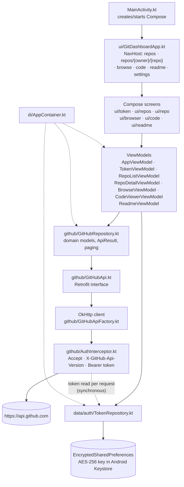

# Git Dashboard

An Android app for browsing your GitHub repositories from a phone: sign in with a personal access
token, list and filter your repositories, open a repository's details, and browse its files with a
read-only code viewer.

- **Package / application ID:** `com.agentroost.gitdashboard`
- **Version:** `0.1.0` (versionCode 1)
- **UI:** Jetpack Compose (Material 3)
- **Source root:** `app/src/main/java/com/agentroost/gitdashboard/`

> **Status note:** the repository list, repository detail, file browser, code viewer and README
> viewer screens are all wired into navigation. Known gaps (branch switching, pull-to-refresh, …)
> are listed under [Known limitations](#known-limitations).

---

## Screenshots

No screenshots are committed yet — `docs/screenshots/` contains only its own README. Drop the files
below into that directory and replace the placeholder cells; the table is the checklist of shots a
release should have. The last three rows are for screens that now exist but whose screenshots are
still **pending**.

| Screen | File | What to capture |
| --- | --- | --- |
| Token onboarding | `docs/screenshots/01-onboarding.png` | Empty state, "Connect your GitHub account" |
| Token verified | `docs/screenshots/02-token-verified.png` | "Verified as &lt;login&gt;" + "Continue to repositories" |
| Repository list | `docs/screenshots/03-repo-list.png` | Populated list showing private badge, stars, language |
| Repository filter | `docs/screenshots/04-repo-filter.png` | Non-empty filter query with matches |
| Repository detail | `docs/screenshots/05-repo-detail.png` | Header, stats grid, "Browse files" / "Open on GitHub" |
| Settings / sign out | `docs/screenshots/06-settings.png` | Masked saved token + "Remove saved token" |
| Error state | `docs/screenshots/07-error.png` | Rate-limit or network error pane |
| File browser (**pending**) | `docs/screenshots/08-file-browser.png` | Path bar, folder/file rows, file sizes, "Open on GitHub" |
| Code viewer (**pending**) | `docs/screenshots/09-code-viewer.png` | Highlighted file with line-number gutter, Open-on-GitHub action |
| README viewer (**pending**) | `docs/screenshots/10-readme-viewer.png` | Rendered headings, list, code block and an embedded screenshot |

---

## Requirements

| Component | Version | Where it comes from |
| --- | --- | --- |
| JDK | **17** | `app/build.gradle.kts` → `sourceCompatibility`/`targetCompatibility` = 17, `jvmTarget = "17"` |
| Android SDK Platform | **35** | `compileSdk = 35`, `targetSdk = 35` |
| Android Studio | Ladybug (2024.2.1) or newer | Needed for the bundled JDK, SDK manager and Gradle tooling for Android Gradle Plugin **8.7.3** (**not verified here** — Studio is not installed in this environment) |
| Gradle | **8.9** | The build cache in this workspace is `.gradle/8.9/`, so that is the version it was last built with; AGP 8.7.3 requires Gradle 8.9+ |
| Kotlin | 2.0.21 | `gradle/libs.versions.toml` |
| Device / emulator | **Android 8.0 (API 26) or newer** | `minSdk = 26` |

You also need:

- A GitHub account and a personal access token (see [Create a personal access token](#create-a-personal-access-token)).
- Network access to `https://api.github.com` **from the phone**, not just from your laptop.

---

## Build and install

### Option A — Android Studio (recommended)

1. **File → Open…** and pick the project directory (`/home/core/GitDashboard` in this workspace).
2. Let Gradle sync finish. If Studio asks for an SDK location, point it at your Android SDK and it
   writes `local.properties` for you.
3. Plug in a phone with USB debugging enabled (Settings → About phone → tap *Build number* 7 times,
   then Settings → System → Developer options → *USB debugging*), or start an emulator with an
   API 26+ system image.
4. Select the `app` run configuration and press **Run ▶**.

### Option B — command line

```sh
# From the project root
./gradlew installDebug
```

This compiles the debug variant and installs it on the one connected device/emulator.

The Gradle wrapper **is committed** — `gradlew`, `gradlew.bat`,
`gradle/wrapper/gradle-wrapper.jar` and `gradle-wrapper.properties` (pinned to Gradle 8.9) — so a
fresh clone needs only a JDK 17+ and an Android SDK, not a local Gradle install.

```sh
./gradlew :app:assembleDebug      # verified: BUILD SUCCESSFUL (Linux, JDK 17, SDK 35)
./gradlew :app:installDebug       # not verified (needs a connected device/emulator + adb)
```

### Install onto a physical device with adb

```sh
adb devices                       # confirm the phone is listed as "device", not "unauthorized"
adb install -r app/build/outputs/apk/debug/app-debug.apk
```

- `adb` ships with the Android SDK platform-tools; with a default Android Studio install on Linux it
  is at `~/Android/Sdk/platform-tools/adb`. **Not verified here** — `platform-tools` is installed in
  the build environment, but no device or emulator was ever connected, so the install step has not
  been exercised.
- The APK output path is real: `app/build/outputs/apk/debug/app-debug.apk` exists in this workspace.
- Over Wi-Fi: *Developer options → Wireless debugging* on the phone, then
  `adb pair <ip>:<port>` followed by `adb connect <ip>:<port>`. **Not verified here.**

Add `adb` to your `PATH` for the session if needed:

```sh
export PATH="$HOME/Android/Sdk/platform-tools:$PATH"   # default Studio SDK location; adjust if yours differs
```

### If Gradle cannot find the SDK

The build needs an SDK path from one of these (in order of precedence):

1. `sdk.dir=/absolute/path/to/Android/Sdk` in a `local.properties` file at the project root —
   this file is **not** present in this workspace and is machine-specific, so it is not committed.
2. The `ANDROID_HOME` environment variable.
3. `ANDROID_SDK_ROOT` (legacy).

Creating `local.properties`:

```sh
printf 'sdk.dir=%s\n' "$HOME/Android/Sdk" > local.properties
```

Verified: with `ANDROID_HOME` pointed at a Platform 35 SDK, `./gradlew :app:assembleDebug`
completes successfully and writes `app/build/outputs/apk/debug/app-debug.apk`.

---

## Create a personal access token

The app authenticates with a **personal access token (PAT)** and sends it as
`Authorization: Bearer <token>` on every call to `api.github.com`. There is no OAuth flow and no
password login.

Open <https://github.com/settings/tokens> and choose one of the two token types.

### Classic token (simplest)

1. *Settings → Developer settings → Personal access tokens → Tokens (classic) → Generate new token
   (classic)*.
2. Name it something like `git-dashboard-phone`.
3. Expiration: your choice — the app has no refresh mechanism, so an expired token simply starts
   returning 401 and you re-paste a new one.
4. Scopes:
   - **`repo`** — required to read **private** repositories (contents, metadata). There is no
     read-only variant of this scope; classic `repo` also grants write access, so treat the token as
     sensitive.
   - Nothing else is required. Public repositories are readable with a token that carries no scopes,
     and `GET /user` (used for verification) works with any valid token.
5. Generate, then copy the `ghp_…` value immediately — GitHub shows it once.

### Fine-grained token (least privilege, recommended)

1. Same page → *Fine-grained tokens → Generate new token*.
2. **Resource owner:** your account (or the org that owns the repos — an org may need to approve the
   request).
3. **Repository access:** *All repositories*, or *Only select repositories* and pick the ones you
   want to see in the app.
4. **Permissions → Repository permissions → Contents: Read-only.** *Metadata: Read-only* is added
   automatically and cannot be removed. No other permissions are needed.
5. Generate and copy the `github_pat_…` value.

Practical differences that matter for this app:

| | Classic | Fine-grained |
| --- | --- | --- |
| Prefix | `ghp_…` | `github_pat_…` |
| Granularity | Account-wide scopes | Per-repository, per-permission |
| Private repo read | `repo` scope (also grants write) | `Contents: Read-only` on selected/all repos |
| Visible repositories | Every repo the account can see | Only the repos selected on the token |

Because fine-grained tokens are scoped per repository, a fine-grained token limited to one repository
will show only that repository in the list. If private repositories are missing, check
*Repository access* first, then the *Contents* permission.

The app verifies a token against `GET /user` **before** saving it, so a mistyped or under-scoped
token is rejected on the onboarding screen rather than silently stored.

---

## First run and usage walkthrough

### 1. Onboarding (first launch only)

No token is stored, so the app opens the **GitHub access** screen:

1. Paste the token into **Personal access token** (input is masked, tokens are case-sensitive — don't
   add spaces).
2. Tap **Verify token**. This calls `GET /user` with a throw-away HTTP client bound to the candidate
   token, so an invalid token never replaces a working one.
3. On success you see **Verified as &lt;your login&gt;**. On failure you see the mapped error message
   (see [Troubleshooting](#troubleshooting)).
4. Tap **Continue to repositories**. The token is stored encrypted on the device and the repository
   list loads.

Note: the token is saved only after GitHub accepts it. If the device's Keystore is unusable, the
app shows *"Secure storage is unavailable on this device, so the token cannot be saved."* and does
**not** fall back to plaintext storage.

### 2. Repository list

`GET /user/repos` with `sort=updated`, `affiliation=owner,collaborator,organization_member`,
30 per page.

- Rows show name, private badge, stars, description, owner · language · "Updated …".
- **Filter by name** is client-side: it matches the repository `name` or `fullName` of rows already
  loaded, case-insensitively. It does not call GitHub's search API.
- Bottom of the list: **Load more** while more pages exist, otherwise **Refresh**.
- On HTTP 401 the app clears the stored token and returns to onboarding.

### 3. Repository detail

Tap a row → `GET /repos/{owner}/{repo}` is loaded once.

- Header: name, owner, visibility badge, Fork / Archived badges, description.
- Stats: stars, forks, watchers. Then default branch, language, last-updated.
- **Refresh** in the top bar re-runs the request.
- **Browse files** opens the file browser at the repository root (see below).
- **View README** opens the repository's README in the markdown viewer (see below).
- **Open on GitHub** opens the repository's `html_url` in your browser.

### 4. Browsing a repository's files

**Browse files** on the detail screen opens the file browser at the repository root. It calls
`GET /repos/{owner}/{repo}/contents/{path}` with the default branch (no `ref` parameter).

- Rows are sorted folders first, then case-insensitively by name.
- Folder rows open that folder; file rows show their size and open the code viewer.
- Symlink and submodule rows are labelled and are **not** tappable, so they are never treated as
  folders.
- The bar under the top bar shows the current path (monospace, `/` at the root), an **up** arrow
  that is disabled at the root, and **Open on GitHub**, which opens the current folder's
  `github.com` tree URL in your browser.
- **Refresh** in the top bar re-requests the current folder and keeps the listing on screen while
  it loads.
- Folder navigation replaces the listing in place rather than pushing a screen per folder, so one
  **Back** press returns to the repository detail screen whichever folder you ended up in.

### 5. Opening a file in the code viewer

Tapping a file row opens the read-only code viewer for that path, highlighting produced on the
device (no source is sent anywhere):

- Files are shown with a line-number gutter and horizontal scrolling; long lines do not wrap.
- Highlighting covers Kotlin, Java, JavaScript/TypeScript, Python, JSON, YAML, Markdown, XML/HTML
  and shell by file extension; every other extension is shown as plain text.
- The toolbar title is the file's repository-relative path. The open-in-GitHub action appears once
  the file has loaded and hands the file's `github.com` blob URL to your browser.
- If the file cannot be shown, a **Preview unavailable** pane explains why and offers **Open on
  GitHub** instead. The cases are: larger than 1 MB (GitHub does not return contents inline), too
  large to render in the app (over 200,000 characters), not returned as base64 (e.g. Git LFS
  pointers), binary content, a payload shorter than its reported size, undecodable base64, or a
  path that is not a regular file.
- A failed request shows the shared error pane with **Retry**; a 401 signs you out exactly as on
  the other screens.

### 6. Viewing a README

**View README** on the detail screen, or tapping a root-level `README.md` / `README.markdown` in
the file browser, opens the markdown viewer. It lists the repository root with
`GET /repos/{owner}/{repo}/contents/`, picks the README case-insensitively (preferring `.md`), and
loads its text from the same endpoint. Everything is read from the repository's **default branch**
(no `ref` parameter), and there is no branch switcher on this screen.

- Headings, paragraphs, bold/italic, inline code, bullet and ordered lists, blockquotes, horizontal
  rules and fenced code blocks are rendered with Material 3 typography; code blocks use the
  app's code palette. Text is selectable and scrolls as one list. Markdown pipe tables and raw HTML
  keep only their text content (see [Known limitations](#known-limitations)).
- Links open in your browser, exactly as written in the markdown.
- Screenshots render full-width with rounded corners. A repository-relative `` is
  resolved against the README's directory and fetched from `api.github.com` **with your token**
  through the contents API, so images in private repositories work; an absolute `http(s)` URL is
  fetched with a plain request that carries **no** token. Bitmaps are downscaled to at most
  ~1440 px wide and cached in memory.
- An image that cannot be shown — GitHub will not inline it (over 1 MB), it is a non-bitmap format
  such as SVG, or the request fails — is replaced by an inline placeholder showing its alt text and
  **Tap to open**, which opens the image's web URL (its `github.com` blob URL for a repository path,
  the URL itself for an absolute one).
- The toolbar shows the README's path, **Refresh**, and **Open on GitHub** (the README's blob URL).
- Missing README (no such file, or an empty repository) shows an explanatory empty state. A README
  GitHub will not inline (larger than 1 MB, binary or LFS) shows the reason plus **Open on GitHub**.
  A failed request shows the shared error pane with **Retry**; a 401 signs you out.

### 7. Settings / signing out

Gear icon on the repository list → **Settings**:

- Shows the saved token masked as `ghp_…1a2b` (first and last four characters).
- **Remove saved token** wipes the encrypted entry and drops you back on onboarding.
- Pasting a new token and verifying it replaces the old one; the authenticated screen graph is
  recreated, so no cached data from the previous account survives.

---

## Architecture

One authenticated OkHttp client per process, a single Retrofit interface, and a manually constructed
dependency container (`di/AppContainer.kt` — no Hilt/Koin). A second, interceptor-free client exists
only for absolute README image URLs (see [Privacy](#privacy)).

```
UI (Compose)  ->  ViewModel  ->  Repository  ->  GitHubApi (Retrofit)  ->  OkHttp  ->  api.github.com
                     |                                ^
                     |                                |
                     +--> TokenRepository             +-- AuthInterceptor reads the token per request
                          (EncryptedSharedPreferences + Android Keystore)
```



### Layers and the files that implement them

| Layer | File(s) | Responsibility |
| --- | --- | --- |
| Entry point | `app/src/main/java/com/agentroost/gitdashboard/MainActivity.kt`, `GitDashboardApplication.kt` | Hosts Compose; the `Application` builds `AppContainer` |
| DI | `app/src/main/java/com/agentroost/gitdashboard/di/AppContainer.kt` | Owns the token repository, the OkHttp client, `GitHubApi`, `GitHubRepository` |
| Navigation | `app/src/main/java/com/agentroost/gitdashboard/ui/GitDashboardApp.kt` | `Routes.REPOS`, `Routes.REPO_DETAIL`, `Routes.BROWSE`, `Routes.CODE`, `Routes.README`, `Routes.SETTINGS`; onboarding vs. authenticated graph |
| UI | `ui/token/TokenScreen.kt`, `ui/repos/RepoListScreen.kt`, `ui/repo/RepoDetailScreen.kt`, `ui/browser/BrowseScreen.kt`, `ui/code/CodeViewerScreen.kt`, `ui/readme/ReadmeScreen.kt`, `ui/components/*` | Compose screens + shared error/empty/loading panes |
| ViewModels | `ui/AppViewModel.kt` (session), `ui/token/TokenViewModel.kt`, `ui/repos/RepoListViewModel.kt`, `ui/repo/RepoDetailViewModel.kt`, `ui/browser/BrowseViewModel.kt`, `ui/code/CodeViewerViewModel.kt`, `ui/readme/ReadmeViewModel.kt` | State machines; expose `StateFlow` UI state; one in-flight request at a time |
| README rendering | `ui/readme/MarkdownParser.kt`, `ui/readme/ReadmeImageRefs.kt`, `ui/readme/ReadmeImageLoader.kt` | Dependency-free markdown blocks, image-source resolution, authenticated/plain image fetching with bitmap downscaling |
| Repository | `github/GitHubRepository.kt` | The only API surface ViewModels see; maps DTO → domain, decodes paging and contents |
| Network | `github/GitHubApi.kt`, `GitHubApiFactory.kt`, `AuthInterceptor.kt`, `ApiCall.kt`, `ApiResult.kt`, `Paging.kt`, `GitHubContentDecoder.kt`, `GitHubUrls.kt` | Retrofit endpoints, headers, error mapping, `Link` pagination, base64 decoding, path encoding and web URLs |
| Wire models | `github/model/GitHubDtos.kt` | `@Serializable` DTOs |
| Domain models | `domain/model/Repository.kt`, `domain/model/Contents.kt` | What the UI renders |
| Syntax highlighting | `ui/code/CodeHighlighter.kt` | Extension → language mapping, token styling, line numbers (dependency-free) |
| Token storage | `data/auth/TokenRepository.kt` | `EncryptedSharedPreferences` (`git_dashboard_secure_tokens`, key `github_pat`), AES-256-GCM master key in the Keystore |

### Error handling

`github/ApiCall.kt` wraps every call in `safeApiCall`, which runs on `Dispatchers.IO` and converts
transport exceptions, non-2xx statuses and decode failures into the typed `ApiError` sealed interface
(`Unauthorized`, `RateLimited`, `Forbidden`, `NotFound`, `Http`, `Network`, `Serialization`,
`Unknown`). No exception text reaches the UI; `ui/components/ApiErrorText.kt` maps each error to a
string resource. Rate-limit reset times come from `X-RateLimit-Reset` and are rendered as a local
clock time.

### Token storage model

- Written only after `GET /user` accepts the token (`TokenViewModel.verifyAndSave`).
- Encrypted at rest with `EncryptedSharedPreferences`; the master key lives in the Android Keystore.
- Read **per request** through `AuthInterceptor`, so replacing the token does not rebuild the network
  stack.
- On session expiry (401) it is deleted (`AppViewModel.onSessionExpired`).
- No logging interceptor is installed, deliberately: an HTTP logger would print the
  `Authorization` header.

---

## Troubleshooting

| Symptom | Likely cause | Fix |
| --- | --- | --- |
| Onboarding shows *"GitHub rejected the token. Please enter a valid personal access token."* (HTTP 401) | Token revoked, expired, copied incompletely, or created for a different account | Create a new token at <https://github.com/settings/tokens>, copy the whole value (`ghp_…` / `github_pat_…`), paste without spaces/trailing newline, tap **Verify token**. If a token was already stored, the app has cleared it and returned to onboarding — paste the new one. |
| *"This token is not allowed to access the requested data."* (403 that is not a rate limit), or GitHub's own 403 message | Token lacks the scope/permission, or the org requires SSO authorization | Classic: add the `repo` scope. Fine-grained: `Contents: Read-only` plus *Repository access* covering that repo. For org repos, authorize the token for the org (SSO). GitHub's own message is shown when it sends one. |
| *"GitHub rate limit exceeded. It resets at 14:32."* (or the variant without a time) | HTTP 403 with `X-RateLimit-Remaining: 0`, or HTTP 429 (secondary limit) | Wait until the reset time shown (device local time, from `X-RateLimit-Reset`). Authenticated requests typically allow 5,000/hour; the app makes one call per screen/refresh, but repeated **Refresh** taps still count. If no time is shown, GitHub sent no reset header — wait a minute and retry. |
| *"Network error. Check your connection and retry."* | Airplane mode, no Wi-Fi/cellular, captive portal, DNS/TLS failure, or a timeout | Restore connectivity and retry. The client uses 15 s connect, 30 s read/write and 45 s call timeouts, so a stalled connection surfaces as this error rather than hanging. Emulators on a VPN host sometimes lose `api.github.com`; check the emulator's browser. |
| *"Secure storage is unavailable on this device, so the token cannot be saved."* | The Keystore-backed preferences could not be created (e.g. an invalidated keystore entry, some rooted/custom ROMs) | There is no plaintext fallback by design. Clear the app's data or reinstall the app to recreate the master key and try again. |
| Build: *"SDK location not found"* / *"Failed to install the following Android SDK packages"* | No `ANDROID_HOME`, no `local.properties`, or platform 35 / build-tools missing | Install **Android SDK Platform 35** and **Build-Tools 35.0.0**, then set `ANDROID_HOME` or add `sdk.dir=…` to `local.properties` (see above). |
| Build: `./gradlew: No such file or directory`, or *"Could not find or load main class org.gradle.wrapper.GradleWrapperMain"* (wrapper jar missing) | The wrapper files were deleted, or the checkout came from an archive that dropped them | Restore them from version control (`git checkout -- gradlew gradlew.bat gradle/wrapper`), or regenerate with any local Gradle 8.9: `gradle wrapper --gradle-version 8.9`. The wrapper jar is committed and must stay tracked. |
| Build fails with an unsupported class file / language level error | Gradle picked a JDK other than 17 | Set *Settings → Build, Execution, Deployment → Build Tools → Gradle → Gradle JDK* to **17**, or `JAVA_HOME` to a JDK 17 for CLI builds. |
| **Browse files** shows an empty folder at the repository root | GitHub answers 404 for the root of a repository with no commits, and the browser renders that as an empty folder | Push at least one commit to the default branch. A 404 for a folder *inside* the repository is shown as an error instead. |
| A file opens a **Preview unavailable** pane: *"larger than 1 MB"* or *"too large to display in the app"* | GitHub returns at most 1 MB of contents inline, and the viewer refuses text above 200,000 characters to avoid freezing the UI | Use **Open on GitHub** from that pane; the file is not downloadable inside the app. |
| A README screenshot shows **Image unavailable** | The image is above GitHub's 1 MB inline limit, is not a bitmap (e.g. SVG), the path is broken, or the download failed — including an absolute URL on a host the phone cannot reach | Tap the placeholder to open the image's web URL. For a repository image, commit a PNG/JPEG/WebP/GIF below 1 MB; for an external URL, check that the phone's browser can load it. |
| Files you expect are missing from the browser | The browser reads the repository's **default branch** only — there is no branch/ref switcher yet, and the README viewer has none either | Change the default branch on GitHub. **Open on GitHub** also lands on the default branch; switch branch there. |

---

## Privacy

The token is the only secret the app handles, and it stays on the device:

- **At rest:** stored in `EncryptedSharedPreferences` (`git_dashboard_secure_tokens`) encrypted with
  an AES-256-GCM master key held by the **Android Keystore**. If that storage is unavailable, the app
  refuses to save anything rather than writing plaintext.
- **In transit:** sent only to `https://api.github.com`, as an `Authorization: Bearer <token>` header.
  The GitHub API client contacts no other host; cleartext traffic is disabled
  (`usesCleartextTraffic="false"`). README images follow the same rule: a repository-relative image
  path is downloaded from `https://api.github.com` with the token, while an absolute `http(s)` image
  URL is downloaded by a separate interceptor-free client, so that host never sees the token.
- **Not logged:** no OkHttp logging interceptor is installed and the token repository logs only the
  exception class name on failure — never the token or Keystore payload.
- **Not backed up:** `android:allowBackup="false"`, so app data (including the encrypted token) is
  excluded from Android cloud backup.
- **No analytics or third-party SDKs:** the dependencies are AndroidX, Compose, Retrofit/OkHttp,
  kotlinx.serialization and kotlinx.coroutines.
- The **Open on GitHub** actions (repository, current folder, single file) hand a plain `github.com`
  URL to your browser; no token is passed to the browser.

Removing the token: **Settings → Remove saved token** deletes it immediately. Uninstalling the app
also removes it (and the Keystore key).

---

## Project layout

```
GitDashboard/
├── build.gradle.kts                 # top-level: plugin aliases only
├── settings.gradle.kts              # rootProject.name = "GitDashboard", includes :app
├── gradle.properties                # Gradle JVM args, AndroidX flags
├── gradle/libs.versions.toml        # version catalog (AGP 8.7.3, Kotlin 2.0.21, Compose BOM 2024.12.01)
└── app/
    ├── build.gradle.kts             # compileSdk/targetSdk 35, minSdk 26, Java 17
    ├── proguard-rules.pro
    └── src/main/
        ├── AndroidManifest.xml      # INTERNET permission, allowBackup=false
        ├── java/com/agentroost/gitdashboard/
        │   ├── MainActivity.kt, GitDashboardApplication.kt
        │   ├── data/auth/TokenRepository.kt
        │   ├── di/AppContainer.kt
        │   ├── domain/model/{Repository,Contents}.kt
        │   ├── github/…             # api, factory, interceptor, repository, mapping, paging
        │   ├── ui/…                 # AppViewModel, GitDashboardApp, screens, theme, components
        │   └── util/{Formatting,RelativeTime}.kt
        └── res/                     # strings, themes, launcher icons
```

Developer docs: **[DEV_NOTES.md](DEV_NOTES.md)** (adding screens/endpoints, DTOs, tests).

## Known limitations

- **No branch or ref switching.** `GitHubRepository.repositoryContents`, `filePreview` and
  `imageBytes` accept a `ref`, but neither the browser, the code viewer nor the README viewer passes
  one, so every listing, file, README and README image comes from the repository's default branch.
- **No pull-to-refresh**; refresh is a toolbar action / list-footer button.
- **No token refresh or OAuth**; an expired token must be replaced manually.
- **Repository filter is client-side** over already loaded pages, not a GitHub code/repo search.
- **The file browser loads one folder per request** (no paging). A directory is requested once; the
  app does not page through huge directories.
- **The code viewer only renders text** (the README viewer does render images). Archives and other
  binaries end up in the **Preview unavailable** pane; there is no download or save action.
- **README rendering covers a markdown subset.** GitHub pipe tables render as plain pipe-separated
  rows, raw HTML is stripped to its text content (an `` tag is not shown — only markdown
  `` images are), images larger than 1 MB cannot be fetched through the contents API,
  SVG and other non-bitmap formats fall back to the image placeholder, and animated GIFs show their
  first frame. Relative links are handed to the browser unresolved.
- **README images are cached in memory only.** Nothing is written to disk, so every image is
  fetched again after the process is recreated.
- **No instrumented tests.** `app/src/androidTest` is empty, although JVM unit tests now exist under
  `app/src/test/` — see DEV_NOTES.md.

## License

Licensed under the **Apache License, Version 2.0**. See [LICENSE](LICENSE) for the full text.

```
Copyright 2026 Radu Ichim

Licensed under the Apache License, Version 2.0 (the "License");
you may not use this file except in compliance with the License.
You may obtain a copy of the License at

    http://www.apache.org/licenses/LICENSE-2.0

Unless required by applicable law or agreed to in writing, software
distributed under the License is distributed on an "AS IS" BASIS,
WITHOUT WARRANTIES OR CONDITIONS OF ANY KIND, either express or implied.
See the License for the specific language governing permissions and
limitations under the License.
```

Apache-2.0 was chosen over MIT for its explicit patent grant, which is the
convention across the Android/AndroidX ecosystem this app builds on. Third-party
dependencies (AndroidX, Compose, Kotlin, Retrofit, OkHttp, kotlinx, Robolectric,
JUnit) remain under their own respective licenses.

`GitHub`, `GitHub API` and the GitHub logo are trademarks of GitHub, Inc. This
project is not affiliated with or endorsed by GitHub.
